<div align="center">


</div>

# Sujit Nirmal

**I'm Sujit.** I build at the point where machine learning stops being a research artifact and starts becoming a real system.

My work sits across **Machine Learning, Deep Learning, LLMs, agentic systems, retrieval, evaluation, computer vision, and product engineering**. I care about what happens after the demo: messy inputs, imperfect models, latency, observability, cost, reliability, and the engineer who eventually has to operate the thing.

I've worked on systems that moved **revenue, user engagement, and engineering velocity** — not just benchmark scores.


[Portfolio](https://sujit.top) · [Writing](https://blackshadow.hashnode.dev) · [LinkedIn](https://linkedin.com/in/sujit-nirmal) · [X](https://x.com/sujit_nirmal05)

## Hackathons and Impact

| Result | Where | What |
| --- | --- | --- |
| **1st of 52** | WhipScribe Buildathon 2026 | [CallCoach-AI](https://callcoachai.sujit.top): four agents score a call, and every flag plays from the second it was said. |
| **0.45 → 0.79 accuracy** | Datathon 2025, 2nd runner-up | TF-IDF and logistic regression. A teammate carried the online round while I was in hospital. |
| **Top 30 nationwide** | Hackspiration '24 | [HarvestConnect](https://github.com/Blacksujit/HarvestConnect), a farm-to-buyer marketplace. |
| **Shortlisted for the finals** | 100x Engineers GenAI Hackathon 2024 | [Dataviz AI](https://github.com/Blacksujit/100X-Engineers-GenAI-Hackathon-Submission) turns raw data into animated infographic videos. |
| **Shortlisted, internal round** | Smart India Hackathon 2024 | [ArogyaKrishi](https://github.com/Blacksujit/ArogyaKrishi), crop disease and soil analysis. |
| **300+ users** | [CallCoach-AI](https://callcoachai.sujit.top) | Founders and sales teams scoring their calls. Real traffic: enough of it that we ran through our API quota. |
| **+2% revenue** | [Launchpad.AI](https://www.launchpad.ai/) | Multi-agent and Graph-RAG systems shipped to a live customer. I ran the retrieval evals and the A/B ranking tests. |
| **30 PRs merged** | Open source, Oct 2026 | pandas-stubs, typeshed, MLflow, DSPy, ONNX, Hugging Face Hub and Kestra. |
| **30+ contributors** | [HeadOn](https://headon.ai/) | Coordinated the training-data labelling and ran the precision, recall and F1 evals that decided what to fix next. |

## What I'm building

**[CallCoach-AI](https://callcoachai.sujit.top)** scores a founder's investor call with four agents. Every flag has a button that plays the recording from the second it was said, so you can check it yourself. It won the [WhipScribe Buildathon](https://whipscribe.com/buildathon) in October 2026, first of 52 builders. [Code](https://github.com/Blacksujit/callcoach-ai-whhipscribe) · [How it works](https://sujit.top/missions/callcoach)

**[ArogyaKrishi](https://github.com/Blacksujit/ArogyaKrishi)** is my most-starred repo. A farmer uploads a photo of a leaf or of the soil and gets back the crop disease, the soil type, and crop and fertilizer recommendations. Disease detection is a ResNet9, soil type comes from DenseNet121 and SoilNet, and crop recommendation is a random forest. Built with team Anant for Smart India Hackathon 2024 (problem statement SIH1638).

**[Sentinel-AI](https://sentinelaihq.com)** sits next to an LLM and scores every prompt and response from 0 to 100, with the claims and flags behind the score, then decides whether to serve, fix or block the answer. The Python SDK is on PyPI as [`sentinelai-risk`](https://pypi.org/project/sentinelai-risk/). [Code](https://github.com/Blacksujit/Sentinel-AI) · [How it works](https://sujit.top/missions/sentinel)

## Activity

<div align="center">




</div>

## Open source

Most of these started the same way: I ran a checker against real code and fixed what it found. For pandas-stubs that meant type-checking 1,116 runnable pandas docstring examples with mypy, pyright, pyrefly and ty. For typeshed it meant running stubtest against the real packages.

| Project | Merged | Some of them |
| --- | :---: | --- |
| [pandas-dev/pandas-stubs](https://github.com/pandas-dev/pandas-stubs/pulls?q=is%3Apr+author%3ABlacksujit+is%3Amerged) | 9 | [DataFrameGroupBy.value_counts](https://github.com/pandas-dev/pandas-stubs/pull/2000), [CategoricalIndex methods](https://github.com/pandas-dev/pandas-stubs/pull/2026), [pd.option_context](https://github.com/pandas-dev/pandas-stubs/pull/2006) |
| [Kestra](https://github.com/search?q=org%3Akestra-io+author%3ABlacksujit+is%3Apr+is%3Amerged&type=pullrequests) | 8 | [kestractl: commands for Kestra 2.0 MCP servers](https://github.com/kestra-io/kestractl/pull/206), [Kafka trigger error handling](https://github.com/kestra-io/plugin-kafka/pull/258), [MCP server trigger state](https://github.com/kestra-io/mcp-server-python/pull/24) |
| [python/typeshed](https://github.com/python/typeshed/pulls?q=is%3Apr+author%3ABlacksujit+is%3Amerged) | 7 | [grpcio](https://github.com/python/typeshed/pull/16565), [pycocotools](https://github.com/python/typeshed/pull/16577), [hnswlib](https://github.com/python/typeshed/pull/16578) |
| [mlflow/mlflow](https://github.com/mlflow/mlflow/pulls?q=is%3Apr+author%3ABlacksujit+is%3Amerged) | 2 | [`attributes.` prefix in search_experiments](https://github.com/mlflow/mlflow/pull/26923) |
| [stanfordnlp/dspy](https://github.com/stanfordnlp/dspy/pulls?q=is%3Apr+author%3ABlacksujit+is%3Amerged) | 2 | [negative numbers in Literal signatures](https://github.com/stanfordnlp/dspy/pull/10678) |
| [onnx/onnx](https://github.com/onnx/onnx/pull/8645) | 1 | [BitCast bit-widths for sub-byte types](https://github.com/onnx/onnx/pull/8645) |
| [huggingface/huggingface_hub](https://github.com/huggingface/huggingface_hub/pull/5212) | 1 | [docs examples that raised TypeError](https://github.com/huggingface/huggingface_hub/pull/5212) |

[](https://github.com/search?q=org:kestra-io+author:Blacksujit+is:pr+is:merged&type=pullrequests)

## Writing

- [My LLM judge quoted the call. I couldn't find a third of its quotes.](https://sujit.top/notes/llm-judge-quotes) (Oct 2026)
- [From hospital bed to hackathon: Datathon 2025](https://blackshadow.hashnode.dev/from-hospital-bed-to-hackathon-glory-how-we-won-2nd-runner-up-at-datathon-2025) (Mar 2025)
- [How I started contributing to open-source ML](https://blackshadow.hashnode.dev/how-i-started-my-open-source-contribution-journey-in-machine-learning) (Oct 2024)

More at [sujit.top/notes](https://sujit.top/notes).

## What I'm studying

What's actually going on inside these models, plus two physics problems I can't leave alone.

| Area | The question | Papers |
| --- | --- | --- |
| **Consciousness and introspection** | Do models know anything about their own internal states? | [Emergent introspective awareness](https://arxiv.org/abs/2601.01828) (2026)<br>[Mechanistic study of introspection](https://arxiv.org/abs/2609.35108) (2026)<br>[Introspection is content-agnostic](https://arxiv.org/abs/2603.05414) (2026)<br>[Subjective experience under self-reference](https://arxiv.org/abs/2510.24797) (2025)<br>[LLMs are aware of their learned behaviors](https://arxiv.org/abs/2501.11120) (2025)<br>[Disproof of LLM consciousness](https://arxiv.org/abs/2512.12802) (2025) |
| **Hallucination** | Why do models make things up, and can we see it coming? | [Why language models hallucinate](https://arxiv.org/abs/2509.04664) (2025)<br>[H-Neurons](https://arxiv.org/abs/2512.01797) (2025)<br>[Deception vs hallucination](https://arxiv.org/abs/2602.14529) (2026)<br>[Topological signatures of hallucination](https://arxiv.org/abs/2609.21096) (2026)<br>[Uncertainty vs hallucination](https://arxiv.org/abs/2605.27016) (2026) |
| **RL and environments** | What do models learn when trained with RL inside environments? | [DeepSeek-R1](https://arxiv.org/abs/2501.12948) (2025)<br>[Does RL add reasoning beyond the base model?](https://arxiv.org/abs/2504.13837) (2025)<br>[Absolute Zero](https://arxiv.org/abs/2505.03335) (2025)<br>[Agent World Model](https://arxiv.org/abs/2602.10090) (2026)<br>[RL world model learning](https://arxiv.org/abs/2602.05842) (2026) |
| **Human-like behaviour** | How close is model behaviour to human cognition? | [LLMs pass the Turing test](https://arxiv.org/abs/2503.23674) (2025)<br>[Emergent misalignment](https://arxiv.org/abs/2502.17424) (2025)<br>[CogToM](https://arxiv.org/abs/2601.15628) (2026)<br>[Human-like reasoning in LLMs](https://arxiv.org/abs/2605.21299) (2026)<br>[Reasoning aligns LMs to human cognition](https://arxiv.org/abs/2602.08693) (2026)<br>[Understanding LLMs](https://arxiv.org/abs/2607.01006) (2026) |
| **LLMs from scratch** | Can I build and run a coding LLM end to end on my own machine? | [Attention Is All You Need](https://arxiv.org/abs/1706.03762) (2017)<br>[FlashAttention](https://arxiv.org/abs/2205.14135) (2022)<br>[GPTQ](https://arxiv.org/abs/2210.17323) (2022)<br>[AWQ](https://arxiv.org/abs/2306.00978) (2023)<br>[QLoRA](https://arxiv.org/abs/2305.14314) (2023)<br>[vLLM](https://arxiv.org/abs/2309.06180) (2023) |
| **Black holes** | What happens where general relativity and quantum mechanics don't fit? | [Hawking radiation](https://doi.org/10.1007/BF02345020) (1975)<br>[Page curve](https://arxiv.org/abs/hep-th/9306083) (1993)<br>[Firewalls](https://arxiv.org/abs/1207.3123) (2012)<br>[Islands](https://arxiv.org/abs/1905.08255) (2019)<br>[Entropy of Hawking radiation](https://arxiv.org/abs/2006.06872) (2020)<br>[EHT M87 image](https://arxiv.org/abs/1906.11238) (2019) |
| **Dark matter** | Overwhelming indirect evidence, still no direct detection. Why? | [Rubin and Ford](https://ui.adsabs.harvard.edu/abs/1970ApJ...159..379R/abstract) (1970)<br>[Bullet Cluster](https://arxiv.org/abs/astro-ph/0608407) (2006)<br>[Planck 2018](https://arxiv.org/abs/1807.06209) (2018)<br>[LZ search](https://arxiv.org/abs/2410.17036) (2024) |

> If my commit graph goes quiet for a week, I'm probably stuck inside a Penrose diagram.

## Stack

```text
sujit/
├── models/        PyTorch · TensorFlow · Hugging Face Transformers · scikit-learn · OpenCV
├── llm-systems/   LangGraph · CrewAI · LlamaIndex · Model Context Protocol · Ollama
│   ├── retrieval/ Graph-RAG on Neo4j · FAISS
│   └── evals/     LLM-as-judge · verbatim-quote checks · precision / recall / F1 · A/B tests
├── backend/       Python · FastAPI · PostgreSQL · Redis · MongoDB
├── mlops/         MLflow · Weights & Biases · DVC · Optuna
├── infra/         Docker · Kubernetes · GitHub Actions · GCP · AWS
└── learning-now/  quantization · KV-cache · inference serving
```

<div align="center">


</div>

## Reach me

<div align="center">

[](mailto:nirmalsujit981@gmail.com) [](https://linkedin.com/in/sujit-nirmal) [](https://sujit.top/) [](https://x.com/sujit_nirmal05) [](https://blackshadow.hashnode.dev)

</div>

<div align="center">



</div>
